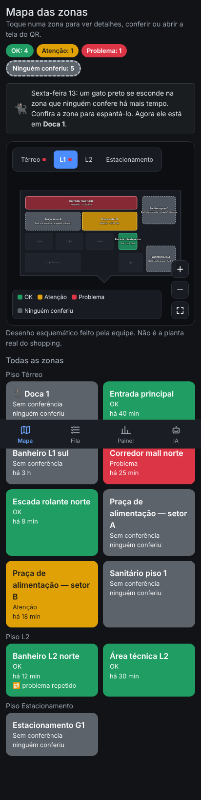
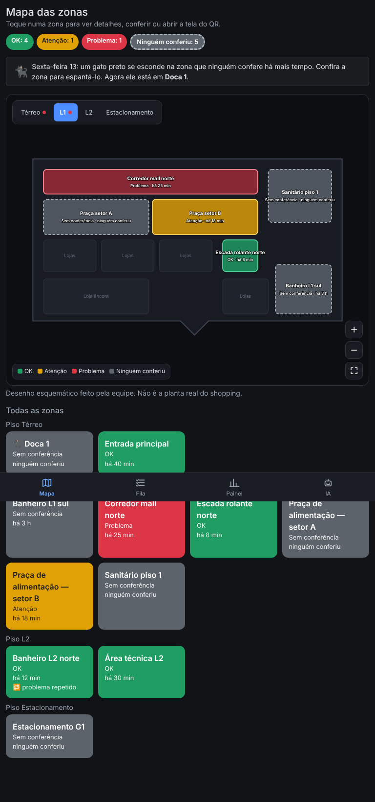
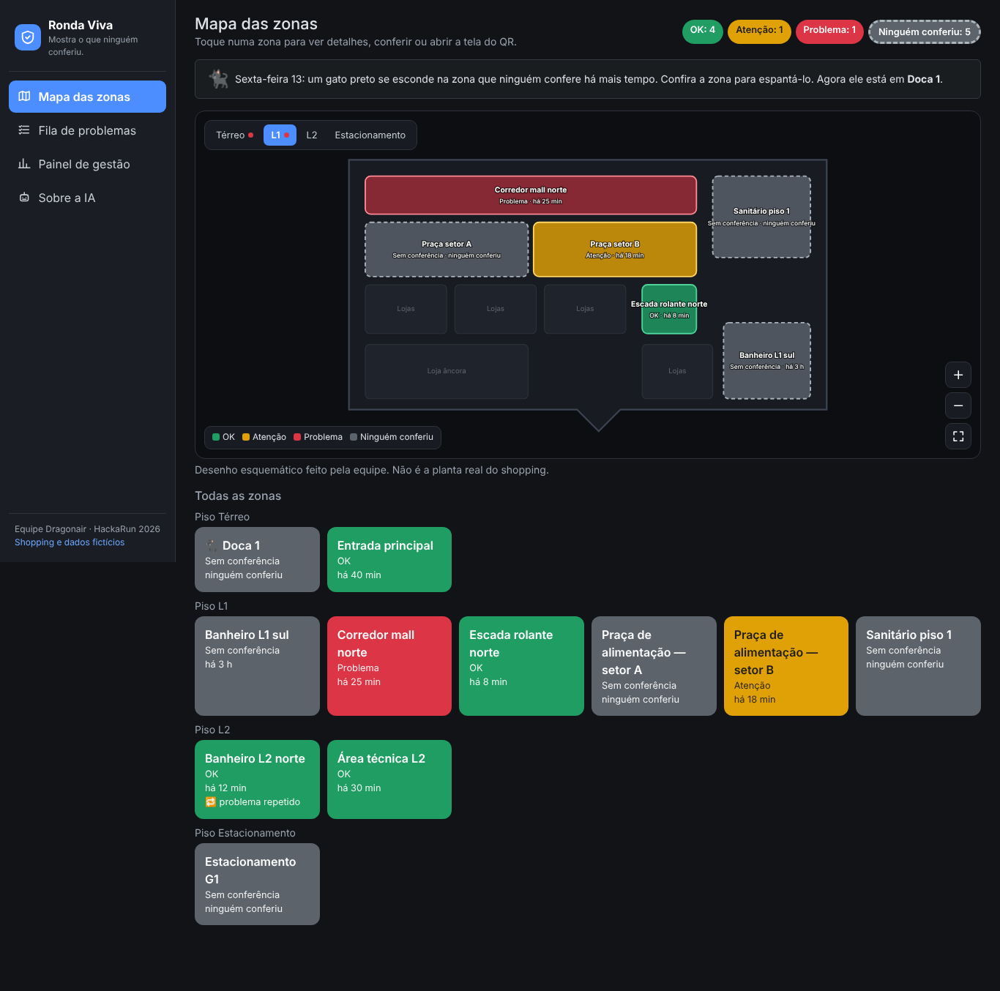
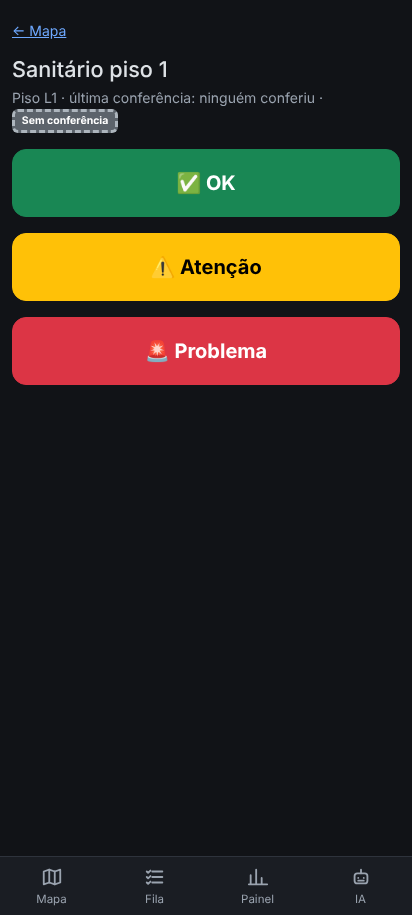
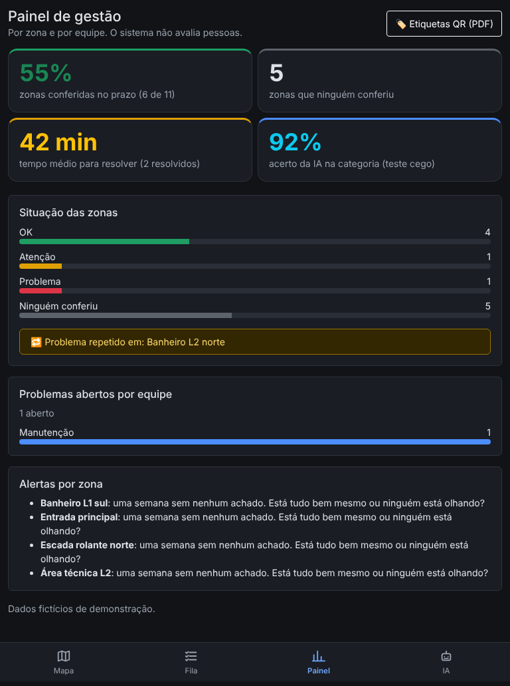
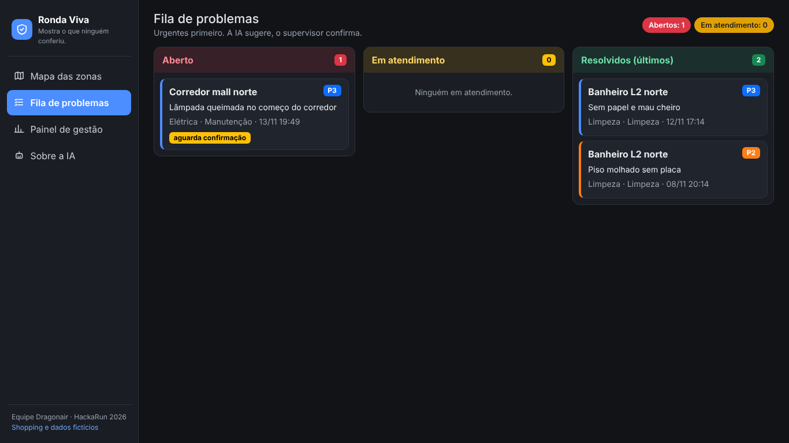
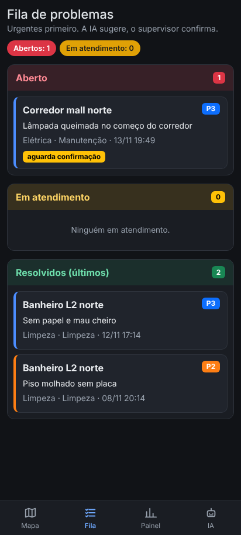
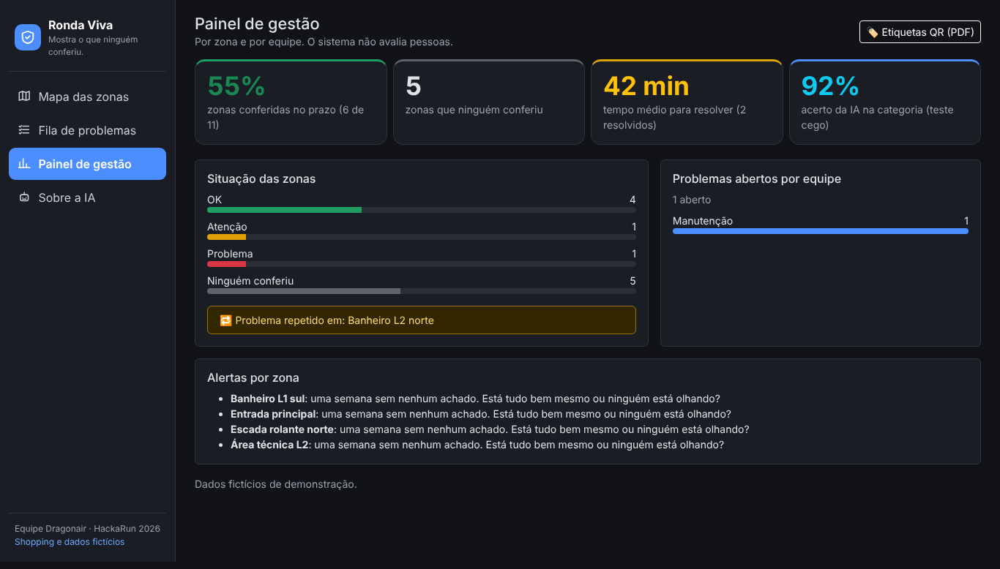

# Evidência: teste de responsividade (13/11, noite)

**Tecnologia sorteada na Roleta: Responsividade.** Testamos as 6 telas em 6 tamanhos de tela, de celular pequeno a monitor grande.

**Como foi feito:** navegador automático (Playwright + Chrome) abriu cada tela em cada tamanho e checou 3 coisas:
1. **Nada vaza para o lado** (sem rolagem horizontal).
2. **Menu certo:** menu de baixo no celular, menu lateral no computador.
3. **Botões fáceis de tocar no celular** (nenhum alvo com menos de ~32 px de altura).
Também conferimos que nenhuma tela teve erro de JavaScript.

## Resultado
| Aparelho (largura) | mapa | zona | fila | problema | painel | ia |
|---|---|---|---|---|---|---|
| celular-pequeno-375 | ✅ | ✅ | ✅ | ✅ | ✅ | ✅ |
| celular-412 | ✅ | ✅ | ✅ | ✅ | ✅ | ✅ |
| tablet-768 | ✅ | ✅ | ✅ | ✅ | ✅ | ✅ |
| tablet-deitado-1280 | ✅ | ✅ | ✅ | ✅ | ✅ | ✅ |
| notebook-1366 | ✅ | ✅ | ✅ | ✅ | ✅ | ✅ |
| monitor-1920 | ✅ | ✅ | ✅ | ✅ | ✅ | ✅ |

**Correção feita durante o teste:** no celular, os botões de piso do mapa, os botões pequenos e os links "← voltar" estavam baixos demais para o dedo. Aumentamos a área de toque (`app/static/css/ronda.css`) e testamos de novo: tudo ✅.

## Prints
| Celular (412 px) | Tablet (768 px) | Notebook (1366 px) |
|---|---|---|
|  |  |  |
|  |  |  |
|  | |  |

**Falta (pessoas):** teste em aparelho de verdade pelo Mateus (Android e iPhone), anotando aqui o modelo do aparelho e o que achou.

Dados e mapa fictícios. O mapa é um desenho da equipe, não a planta do shopping.
